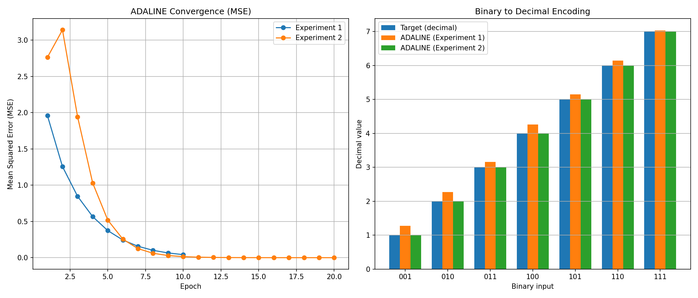
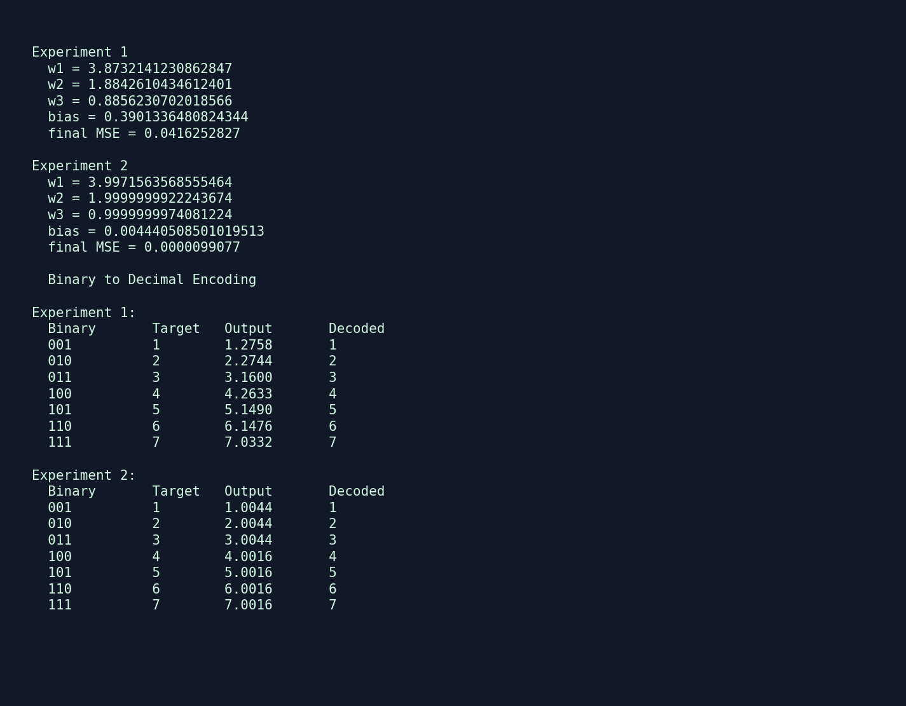

# ADALINE Decimal Encoder

This project demonstrates how an ADALINE neural network learns a relationship
between binary inputs and numerical target values.

The program trains the model using the delta rule. During training, it
calculates an output, compares it with the target value, and updates the
weights and bias to reduce the error.

After training, the program prints the final parameters and the final MSE for
each experiment. It also displays a convergence curve and compares the
predicted decimal values from both experiments with the targets.

## Requirements

- Python 3.9 or later
- NumPy
- Matplotlib

Install the dependencies with:

```bash
pip install -r requirements.txt
```

## Run the project

```bash
python main.py
```

## Results

The convergence plot is saved in the `outputs/` folder. The terminal screenshot
below shows an example run.

The plot shows the MSE convergence of both experiments and their decoded
predictions compared with the target values.



The terminal output shows the final parameters, MSE, and predictions for both
experiments.



## Project Files

- `data.py`: Provides the input data and target values.
- `adaline.py`: Defines the ADALINE model and its training process.
- `main.py`: Runs the experiments and prints the results.
- `visualization.py`: Displays the error graph.
